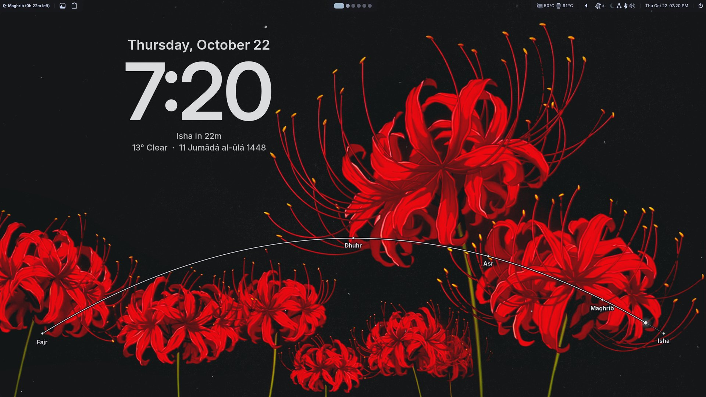
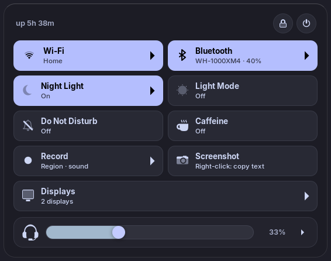
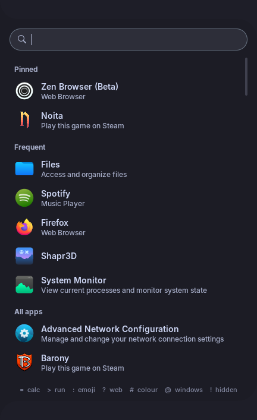
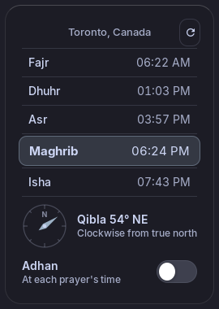
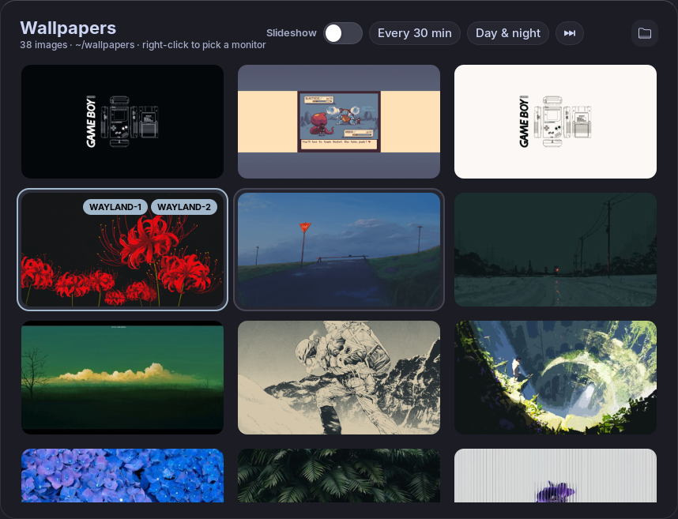
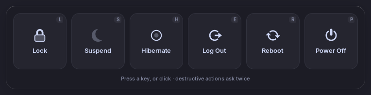

# fabric-nix

My Hyprland desktop shell, built with [Fabric](https://github.com/Fabric-Development/fabric)
(Python + GTK3 widgets on wlr-layer-shell) and packaged for NixOS with flakes.



| Quick settings | Launcher | Prayer times |
|:---:|:---:|:---:|
|  |  |  |

| Wallpaper picker | Power menu |
|:---:|:---:|
|  |  |

## What's in it

- **Bar**: workspaces, clock, tray, prayer times (Qibla compass, adhan, Ramadan
  countdown), clipboard history, system stats (CPU/memory/GPU/network
  sparklines, top processes), battery, recording and privacy indicators,
  system health warnings (failed units, stale pins, full store, pending reboot)
  and a notification center with Do Not Disturb.
- **Quick settings**: Wi-Fi, Bluetooth, night light, light/dark theme, caffeine,
  power profiles, displays, volume and brightness sliders, per-app volume and
  output/input pickers, media player, screenshot and screen recording.
- **Desktop**: a clock that picks a readable spot and colour from the wallpaper,
  weather (Open-Meteo) drawn as rain, snow, fog or stars, a prayer arc, an audio
  visualizer, sticky notes, and a music player card with synced lyrics.
- **Overlays**: app launcher (calculator and unit conversion, `>` run, `:` emoji,
  `?` web search, `#` colours, `@` windows), workspace overview and dock with live
  window previews, radial menu, OSD, notification toasts, wallpaper picker with
  a day/night slideshow, power menu.
- **Theming**: SCSS compiled with dart-sass; the accent colour follows the
  wallpaper, and windows are frosted by Hyprland's layer blur.

## Running

### As a package

```bash
nix run github:muhchaudhary/fabric-nix
```

`packages.default` installs `fabric-config` with the tools it spawns
(dart-sass, wf-recorder, slurp, grim, hyprshot, cliphist, brightnessctl,
tesseract, cava, ...) on its PATH. The compositor side is expected from the
system: Hyprland, hyprpaper, hyprsunset, hyprpicker and, optionally,
power-profiles-daemon and the NVIDIA driver (for GPU stats). The UI uses the
Inter font.

### From a checkout

The dev shell is managed by Nix flakes + direnv. I recommend
[nix-direnv](https://github.com/nix-community/nix-direnv), so the shell is
cached instead of rebuilt on every reload.

```bash
direnv allow          # builds and loads the dev shell
python run_fabric.py  # start the bar
```

Python packages aren't installed globally; they're only available inside the
shell. To use it from outside this directory (e.g. a Hyprland `exec-once`
script):

```bash
#!/usr/bin/env bash

function direnv_cd() {
  cd "$1"
  eval "$(direnv export bash)"
}

direnv_cd /PATH/TO/fabric-nix
exec python run_fabric.py
```

(This works from subdirectories too.)

Logs go to stderr; set `FABRIC_LOG_LEVEL=DEBUG` for more.

## Controlling it

Actions are exposed over D-Bus, so they can be bound to keys:

```bash
dbus-send --session --print-reply --dest=org.Fabric.fabric.fabric-bar \
  /org/Fabric/fabric org.Fabric.fabric.InvokeAction string:"toggle-appmenu" array:string:
```

| Action | Does |
|---|---|
| `toggle-appmenu`, `toggle-overview`, `toggle-radial-menu` | open/close the launcher, overview, radial menu |
| `toggle-notification-center`, `toggle-do-not-disturb` | notifications |
| `toggle-wallpaper-picker` | wallpaper grid |
| `take-screenshot`, `start-screencast`, `stop-screencast` | capture a region; with any argument (`array:string:full`), the focused monitor |
| `copy-text` | select a region and copy its text (OCR) |
| `toggle-system-osd` | show the OSD; the argument names which: `sound`, `mic`, `brightness`, `kbd`, `layout`, `caps` |
| `stop-adhan` | stop the adhan |
| `preview-weather` | show a weather effect on the desktop for 30 s |
| `apply-style` | recompile and reload the CSS without restarting |
| `quit` | quit |

## Development

```bash
ruff check .     # lint
ruff format .    # format
basedpyright .   # type check
nix fmt          # format the Nix files
```

### Type stubs

gi.repository modules are generated at runtime from typelibs, so type
checkers need stubs for them. The dev shell provides
[pygobject-stubs](https://github.com/pygobject/pygobject-stubs) (pinned to
GTK3 in `flake.nix`), plus stubs for the typelibs it doesn't cover (Gray,
Glace, NM, ...) generated by `nix/gi-extra-stubs.nix`. Under direnv, the
shell's Python is linked at `.direnv/python`, which `pyproject.toml` points
basedpyright at.

You can read more about this on the Fabric wiki:
[Getting a Stub Package](https://fabric-development.github.io/fabric-wiki/installing-stubs.html)
